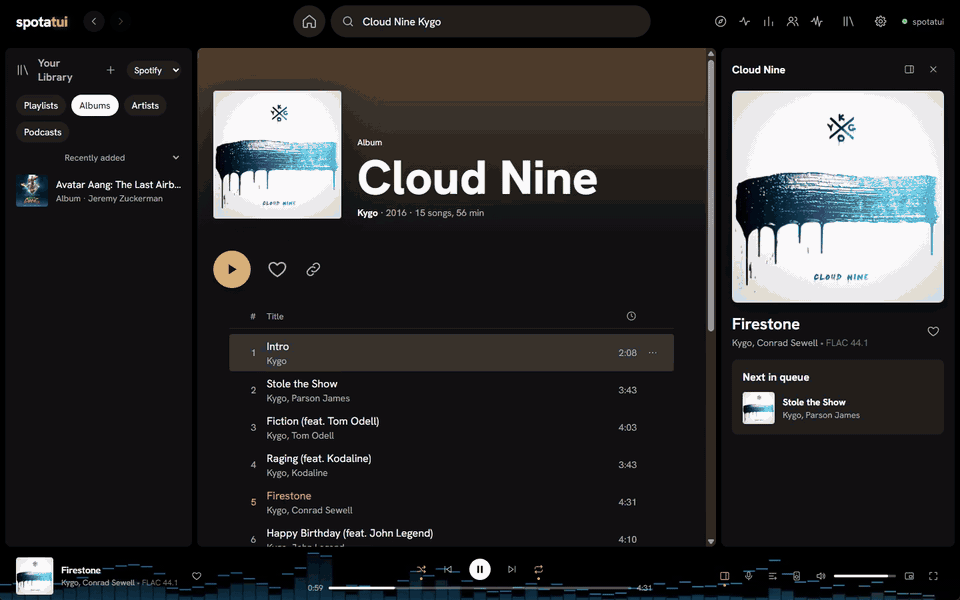
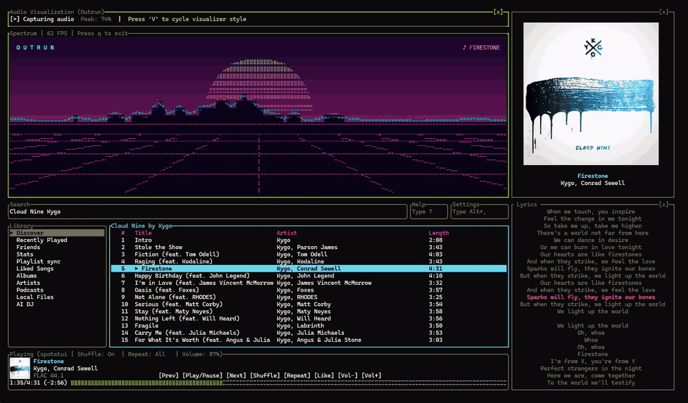

<h1 align="center">
   
  spotatui
</h1>

  Ein schneller Musikplayer für Terminal und Desktop, geschrieben in Rust. 
  Spotify über seinen eigenen eingebauten Client, dazu lokale Dateien, Subsonic/Navidrome, Internetradio, YouTube und Qobuz sowie Apple Music unter macOS.

  <a href="https://spotatui.com/download"><strong>Download</strong></a> · <a href="#installation">Installation</a> · <a href="docs/README.md">Docs</a> · <a href="CONTRIBUTING.md">Mitmachen</a> · <a href="https://spotatui.com/discord">Discord</a>

  <a href="README.md">English</a> | <a href="README.zh-Hans.md">简体中文</a> | <a href="README.zh-Hant.md">繁體中文</a> | <a href="README.fr.md">Français</a> | <b>Deutsch</b>

**Desktop-App**

**Terminal-App**

<!-- START doctoc generated TOC please keep comment here to allow auto update -->
<!-- DON'T EDIT THIS SECTION, INSTEAD RE-RUN doctoc TO UPDATE -->
## Inhaltsverzeichnis

- [Über spotatui](#über-spotatui)
- [Installation](#installation)
- [Schnellstart](#schnellstart)
- [Quellen](#quellen)
- [Mehr erfahren](#mehr-erfahren)
- [Mitmachen](#mitmachen)
- [Wiedergabeverlauf](#wiedergabeverlauf)
- [Star-Verlauf](#star-verlauf)
- [Maintainer](#maintainer)
- [Code-Signatur-Richtlinie](#code-signatur-richtlinie)
- [spotatui-Mitwirkende](#spotatui-mitwirkende)

<!-- END doctoc generated TOC please keep comment here to allow auto update -->

## Über spotatui

spotatui ist ein Musikplayer mit zwei Oberflächen: einer Desktop-App und einer Terminal-App. Beide teilen sich einen Login, eine Konfiguration und einen Wiedergabeverlauf. Spotify ist optional: es ist eine von sieben Quellen.

- Synchronisierte Lyrics und ein Audio-Visualizer in Echtzeit.
- Eine Wiedergabewarteschlange, die Titel aus verschiedenen Quellen mischt.
- [Playlist-Sync](docs/playlist-sync.md): spiegelt eine Playlist auf Spotify, Qobuz, Subsonic oder YouTube.
- [Lua-Plugins](PLUGINS.md) für Befehle, Tasten, Popups und Themes.
- Ein [KI-DJ](docs/ai-dj.md) in der App, oder dein Coding-Agent als DJ über [MCP](docs/mcp-setup.md).
- Ein lokaler Wiedergabeverlauf mit Statistiken und einem teilbaren Jahresrückblick.
- Eine [CLI](docs/cli.md) für Wiedergabe, Suche und Playlists.

**Spotify erfordert Premium.** spotatui meldet sich mit seinem eigenen eingebauten Client an – du brauchst weder eine Entwickler-App noch eine eigene Client-ID.

spotatui begann als Fork von [spotify-tui](https://github.com/Rigellute/spotify-tui) und hat inzwischen einen eigenen Player, eigene Quellen und eine Desktop-App entwickelt.

## Installation

Spotify ist optional: lokale Dateien, Internetradio und YouTube funktionieren ohne Konto, während Subsonic/Navidrome und Qobuz ein Konto benötigen.

**Desktop-App**

| System | Download |
|---|---|
| Windows 10/11 | [Installer](https://spotatui.com/download/windows) |
| macOS | [Apple Silicon](https://spotatui.com/download/macos) · [Intel](https://spotatui.com/download/macos-intel) |
| Linux | [.deb](https://spotatui.com/download/linux-deb) · [.rpm](https://spotatui.com/download/linux-rpm) · [AppImage](https://spotatui.com/download/linux-appimage) |

Die Installer sind noch nicht signiert, daher warnen Windows und macOS beim ersten Start. Der Abschnitt [Desktop-App](docs/installation.md#desktop-app) im Installationsleitfaden zeigt, wie man sie öffnet, und listet die arm64-Dateien für Linux.

**Terminal-App**

| System | Befehl |
|---|---|
| macOS, Linux, WSL | `curl -fsSL https://spotatui.com/install.sh \| bash` |
| Windows | `irm https://spotatui.com/install.ps1 \| iex` oder `winget install spotatui` |
| Arch Linux | `yay -S spotatui-bin` |
| Mit Rust | `cargo install --locked spotatui` |

Homebrew, Nix, Void, `.deb`-Pakete und die Anleitung zum Kompilieren aus dem Quellcode stehen im [Installationsleitfaden](docs/installation.md).

- **Features pro Build:** die vorkompilierten Terminal-Binaries enthalten alle Quellen, den MCP-Server und den KI-DJ. `cargo install` kompiliert nur Spotify, es sei denn, du fügst [die Features](docs/installation.md#which-build-has-which-features) hinzu; der Nix-Flake kompiliert ebenfalls nur Spotify.
- **Updates:** die Terminal-App aktualisiert sich selbst. Falls ein Paketmanager sie installiert hat, setze `behavior.disable_auto_update: true`. Siehe [Aktualisieren](docs/installation.md#updating).

## Schnellstart

Führe `spotatui` aus. Beim ersten Start fragt die App, welche Quellen du nutzen willst. Wähle Spotify zum Anmelden: spotatui zeigt einen Code und öffnet Spotifys Pairing-Seite, auf der du ihn bestätigst.

Dann:

- `?` listet alle Tasten.
- `/` sucht. Wähle das Panel **Songs** mit den Pfeiltasten, drücke `Enter`, um hineinzugehen, und erneut `Enter`, um einen Titel abzuspielen.
- `d` wechselt Quelle und Gerät.
- `z` stellt einen Titel in die Warteschlange, und `Shift+Q` öffnet die Warteschlange.
- `spotatui --help` zeigt die [CLI](docs/cli.md).

## Quellen

| Quelle | Du brauchst |
|---|---|
| **Spotify** | Ein Premium-Konto |
| **Lokale Dateien** | Einen Musikordner |
| **Subsonic / Navidrome** | Ein Serverkonto |
| **Internetradio** | Nichts (30k+ Sender von [radio-browser.info](https://www.radio-browser.info)) |
| **YouTube** | [yt-dlp](https://github.com/yt-dlp/yt-dlp) im `PATH` |
| **Qobuz** | Ein kostenpflichtiges Qobuz-Konto |
| **Apple Music** | macOS und die Musik-App |

Lokale Dateien, Subsonic, Internetradio, YouTube und Qobuz laufen über spotatuis eigene Audio-Engine. Apple Music spielt in der Musik-App, und spotatui ist ihre Fernbedienung. Die Einrichtung jeder Quelle steht unter [Konfiguration](docs/configuration.md).

Spotify spielt in spotatui selbst, auf jedem Spotify-Connect-Gerät oder auf Cast- und Connect-Lautsprechern in deinem Netzwerk. Siehe [Wo Spotify spielt](docs/native-streaming.md#where-spotify-plays). Für verlustfreies Audio oder ein Konto, das natives Streaming nicht abspielen kann, kann spotatui Spotifys eigenen Player ausführen: siehe [Soloist](docs/soloist.md).

## Mehr erfahren

| Du willst | Lies |
|---|---|
| Anders installieren oder aus dem Quellcode kompilieren | [Installation](docs/installation.md) |
| Einstellungen, Tasten oder das Theme ändern | [Konfiguration](docs/configuration.md), [Tastenkürzel](docs/keybindings.md), [Themes](docs/themes.md) |
| spotatui aus deiner Shell steuern | [CLI](docs/cli.md) |
| Ein Lua-Plugin schreiben oder installieren | [PLUGINS.md](PLUGINS.md), [Scripting-API](docs/scripting.md) |
| Eine KI die Musik wählen lassen | [KI-DJ](docs/ai-dj.md), [MCP-Setup](docs/mcp-setup.md) |
| Einen Bug melden | [Neues Issue](https://github.com/LargeModGames/spotatui/issues/new/choose), mit einem `spotatui --debug`-[Log](docs/configuration.md#logging) |
| Alles andere | [Alle Docs](docs/README.md) |

## Mitmachen

spotatui wird von einem kleinen Team und einer wachsenden Gruppe von Mitwirkenden gebaut, und du musst keinen Code schreiben, um zu helfen. Starte mit [CONTRIBUTING.md](CONTRIBUTING.md) oder such dir ein [good first issue](https://github.com/LargeModGames/spotatui/issues?q=is%3Aissue%20state%3Aopen%20label%3A%22good%20first%20issue%22).

Native Wiedergabe und Spotify Connect laufen auf unserem librespot-Fork, [spotatui-librespot](https://github.com/LargeModGames/spotatui-librespot). Er ist Teil des Projekts: ein dort gemergter PR zählt als spotatui-Beitrag. Siehe [Zum librespot-Fork beitragen](CONTRIBUTING.md#contributing-to-the-librespot-fork).

## Wiedergabeverlauf

## Star-Verlauf

<a href="https://www.star-history.com/?type=date&legend=top-left&repos=LargeModGames%2Fspotatui">
 <picture>
   <source media="(prefers-color-scheme: dark)" srcset="https://api.star-history.com/chart?repos=LargeModGames/spotatui&type=date&theme=dark&legend=top-left&sealed_token=iryqtVEb4hcMJpt3uuX43JaGNlZRMV4-stDO4M8-7zH7g186IdrwSCU1PMWBv_YdK7DC4y6qw4sEKu9JXmHbR6c7clp1u8sL1AXI3D_dMW_KTnIjJYKDGw" />
   <source media="(prefers-color-scheme: light)" srcset="https://api.star-history.com/chart?repos=LargeModGames/spotatui&type=date&legend=top-left&sealed_token=iryqtVEb4hcMJpt3uuX43JaGNlZRMV4-stDO4M8-7zH7g186IdrwSCU1PMWBv_YdK7DC4y6qw4sEKu9JXmHbR6c7clp1u8sL1AXI3D_dMW_KTnIjJYKDGw" />
   
 </picture>
</a>

## Maintainer

- **[LargeModGames](https://github.com/LargeModGames)** ([@LargeModGames](https://x.com/LargeModGames) auf X)
- [shilicioo](https://github.com/shilicioo)
- [2570165831](https://github.com/2570165831)
- [Oud](https://github.com/Oud-Idk)

Ursprünglich ein Fork von [spotify-tui](https://github.com/Rigellute/spotify-tui) von [Alexander Keliris](https://github.com/Rigellute). Die spotify-tui-Mitwirkenden und die von spotatui verwendeten Bibliotheken stehen in [CREDITS.md](CREDITS.md).

## Code-Signatur-Richtlinie

Kostenlose Code-Signatur bereitgestellt von [SignPath.io](https://about.signpath.io), Zertifikat von der [SignPath Foundation](https://signpath.org).

Die Windows-Release-Dateien werden von diesem Repository durch den [Release-Workflow](.github/workflows/cd.yml) auf GitHub-gehosteten Runnern gebaut. Jede Signaturanfrage wird von Hand genehmigt.

- Committer und Reviewer: [LargeModGames](https://github.com/LargeModGames), [ThatModGames](https://github.com/ThatModGames), [shilicioo](https://github.com/shilicioo), [2570165831](https://github.com/2570165831), [Oud](https://github.com/Oud-Idk)
- Genehmiger: [LargeModGames](https://github.com/LargeModGames)

Datenschutz: welche Daten spotatui sendet und wie du jeden Teil abschaltest, steht in der [Datenschutzerklärung](https://spotatui.com/privacy).

## spotatui-Mitwirkende

Alle, die geholfen haben, mit oder ohne Code. Um auf diese Liste zu kommen, siehe [Anerkennung](CONTRIBUTING.md#recognition).

Die vollständige Liste der Mitwirkenden steht im [englischen README](README.md#spotatui-contributors). Dieses Projekt folgt der [all-contributors](https://github.com/all-contributors/all-contributors)-Spezifikation.
