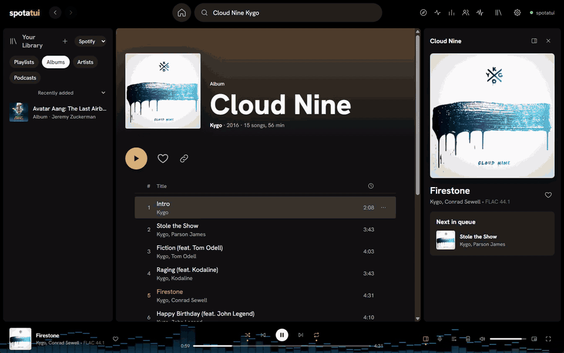
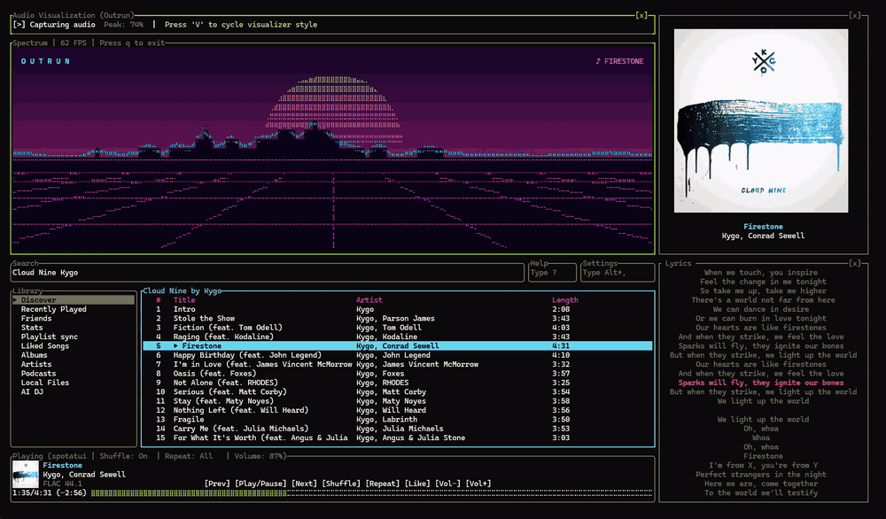

<h1 align="center">
   
  spotatui
</h1>

  Un lecteur de musique rapide pour le terminal et le bureau, écrit en Rust. 
  Spotify via son propre client intégré, plus les fichiers locaux, Subsonic/Navidrome, la radio internet, YouTube et Qobuz, et Apple Music sur macOS.

  <a href="https://spotatui.com/download"><strong>Télécharger</strong></a> · <a href="#installation">Installer</a> · <a href="docs/README.md">Docs</a> · <a href="CONTRIBUTING.md">Contribuer</a> · <a href="https://spotatui.com/discord">Discord</a>

**Application de bureau**

**Application terminal**

<!-- START doctoc generated TOC please keep comment here to allow auto update -->
<!-- DON'T EDIT THIS SECTION, INSTEAD RE-RUN doctoc TO UPDATE -->
## Table des matières

- [À propos](#à-propos)
- [Installation](#installation)
- [Démarrage rapide](#démarrage-rapide)
- [Sources](#sources)
- [En savoir plus](#en-savoir-plus)
- [Contribuer](#contribuer)
- [Historique des écoutes](#historique-des-écoutes)
- [Historique des étoiles](#historique-des-étoiles)
- [Mainteneurs](#mainteneurs)
- [Politique de signature du code](#politique-de-signature-du-code)
- [Contributeurs de spotatui](#contributeurs-de-spotatui)

<!-- END doctoc generated TOC please keep comment here to allow auto update -->

## À propos

spotatui est un lecteur de musique avec deux interfaces : une application de bureau et une application terminal. Elles partagent une seule connexion, une seule configuration et un seul historique d'écoute. Spotify est facultatif : c'est l'une des sept sources.

- Paroles synchronisées et visualiseur audio en temps réel.
- Une file de lecture qui mélange des pistes de différentes sources.
- [Synchronisation de playlists](docs/playlist-sync.md) : reflète une playlist sur Spotify, Qobuz, Subsonic ou YouTube.
- [Plugins Lua](PLUGINS.md) pour les commandes, les touches, les popups et les thèmes.
- Un [DJ IA](docs/ai-dj.md) intégré à l'application, ou votre agent de codage comme DJ via [MCP](docs/mcp-setup.md).
- Un historique d'écoute local avec des statistiques et un récapitulatif partageable.
- Une [CLI](docs/cli.md) pour la lecture, la recherche et les playlists.

**Spotify nécessite Premium.** spotatui se connecte avec son propre client intégré : pas besoin d'application développeur ni d'ID client.

spotatui est né d'un fork de [spotify-tui](https://github.com/Rigellute/spotify-tui) et a depuis développé son propre lecteur, ses sources et son application de bureau.

## Installation

Spotify est facultatif : les fichiers locaux, la radio internet et YouTube fonctionnent sans compte, tandis que Subsonic/Navidrome et Qobuz demandent un compte.

**Application de bureau**

| Système | Téléchargement |
|---|---|
| Windows 10/11 | [Programme d'installation](https://spotatui.com/download/windows) |
| macOS | [Apple Silicon](https://spotatui.com/download/macos) · [Intel](https://spotatui.com/download/macos-intel) |
| Linux | [.deb](https://spotatui.com/download/linux-deb) · [.rpm](https://spotatui.com/download/linux-rpm) · [AppImage](https://spotatui.com/download/linux-appimage) |

Les programmes d'installation ne sont pas encore signés : Windows et macOS affichent donc un avertissement au premier lancement. [Application de bureau](docs/installation.md#desktop-app) montre comment l'ouvrir et liste les fichiers arm64 pour Linux.

**Application terminal**

| Système | Commande |
|---|---|
| macOS, Linux, WSL | `curl -fsSL https://spotatui.com/install.sh \| bash` |
| Windows | `irm https://spotatui.com/install.ps1 \| iex` ou `winget install spotatui` |
| Arch Linux | `yay -S spotatui-bin` |
| Avec Rust | `cargo install --locked spotatui` |

Homebrew, Nix, Void, les paquets `.deb` et la compilation depuis les sources sont dans le [guide d'installation](docs/installation.md).

- **Fonctionnalités par build :** les binaires terminal précompilés incluent toutes les sources, le serveur MCP et le DJ IA. `cargo install` ne compile que Spotify, sauf si vous ajoutez [les fonctionnalités](docs/installation.md#which-build-has-which-features), et le flake Nix ne compile que Spotify.
- **Mises à jour :** l'application terminal se met à jour elle-même. Si un gestionnaire de paquets l'a installée, définissez `behavior.disable_auto_update: true`. Voir [Mise à jour](docs/installation.md#updating).

## Démarrage rapide

Lancez `spotatui`. Au premier lancement, il vous demande quelles sources vous voulez. Choisissez Spotify pour vous connecter : spotatui affiche un code et ouvre la page d'appairage de Spotify, où vous le confirmez.

Ensuite :

- `?` liste toutes les touches.
- `/` recherche. Choisissez le panneau **Songs** avec les flèches, appuyez sur `Entrée` pour y entrer, puis de nouveau `Entrée` pour jouer une piste.
- `d` change la source et l'appareil.
- `z` met une piste en file, et `Maj+Q` ouvre la file.
- `spotatui --help` affiche la [CLI](docs/cli.md).

## Sources

| Source | Il vous faut |
|---|---|
| **Spotify** | Un compte Premium |
| **Fichiers locaux** | Un dossier de musique |
| **Subsonic / Navidrome** | Un compte serveur |
| **Radio internet** | Rien (plus de 30 000 stations de [radio-browser.info](https://www.radio-browser.info)) |
| **YouTube** | [yt-dlp](https://github.com/yt-dlp/yt-dlp) dans votre `PATH` |
| **Qobuz** | Un compte Qobuz payant |
| **Apple Music** | macOS et l'app Musique |

Les fichiers locaux, Subsonic, la radio internet, YouTube et Qobuz passent par le moteur audio propre de spotatui. Apple Music joue dans l'app Musique, et spotatui est sa télécommande. La configuration de chaque source est dans [Configuration](docs/configuration.md).

Spotify joue dans spotatui lui-même, sur n'importe quel appareil Spotify Connect, ou sur des enceintes Cast et Connect de votre réseau. Voir [Où Spotify joue](docs/native-streaming.md#where-spotify-plays). Pour l'audio sans perte, ou un compte que le streaming natif ne peut pas jouer, spotatui peut lancer le propre lecteur de Spotify : voir [Soloist](docs/soloist.md).

## En savoir plus

| Vous voulez | Lire |
|---|---|
| Installer autrement, ou compiler depuis les sources | [Installation](docs/installation.md) |
| Changer les réglages, les touches ou le thème | [Configuration](docs/configuration.md), [Raccourcis clavier](docs/keybindings.md), [Thèmes](docs/themes.md) |
| Contrôler spotatui depuis votre shell | [CLI](docs/cli.md) |
| Écrire ou installer un plugin Lua | [PLUGINS.md](PLUGINS.md), [API de script](docs/scripting.md) |
| Laisser une IA choisir la musique | [DJ IA](docs/ai-dj.md), [Configuration MCP](docs/mcp-setup.md) |
| Signaler un bug | [Nouvelle issue](https://github.com/LargeModGames/spotatui/issues/new/choose), avec un [journal](docs/configuration.md#logging) `spotatui --debug` |
| Tout le reste | [Toute la doc](docs/README.md) |

## Contribuer

spotatui est construit par une petite équipe et un groupe grandissant de contributeurs, et vous n'avez pas besoin d'écrire du code pour aider. Commencez par [CONTRIBUTING.md](CONTRIBUTING.md), ou choisissez une [good first issue](https://github.com/LargeModGames/spotatui/issues?q=is%3Aissue%20state%3Aopen%20label%3A%22good%20first%20issue%22).

La lecture native et Spotify Connect reposent sur notre fork de librespot, [spotatui-librespot](https://github.com/LargeModGames/spotatui-librespot). Il fait partie du projet : une PR fusionnée là-bas compte comme une contribution à spotatui. Voir [Contribuer au fork librespot](CONTRIBUTING.md#contributing-to-the-librespot-fork).

## Historique des écoutes

## Historique des étoiles

<a href="https://www.star-history.com/?type=date&legend=top-left&repos=LargeModGames%2Fspotatui">
 <picture>
   <source media="(prefers-color-scheme: dark)" srcset="https://api.star-history.com/chart?repos=LargeModGames/spotatui&type=date&theme=dark&legend=top-left&sealed_token=iryqtVEb4hcMJpt3uuX43JaGNlZRMV4-stDO4M8-7zH7g186IdrwSCU1PMWBv_YdK7DC4y6qw4sEKu9JXmHbR6c7clp1u8sL1AXI3D_dMW_KTnIjJYKDGw" />
   <source media="(prefers-color-scheme: light)" srcset="https://api.star-history.com/chart?repos=LargeModGames/spotatui&type=date&legend=top-left&sealed_token=iryqtVEb4hcMJpt3uuX43JaGNlZRMV4-stDO4M8-7zH7g186IdrwSCU1PMWBv_YdK7DC4y6qw4sEKu9JXmHbR6c7clp1u8sL1AXI3D_dMW_KTnIjJYKDGw" />
   
 </picture>
</a>

## Mainteneurs

- **[LargeModGames](https://github.com/LargeModGames)** ([@LargeModGames](https://x.com/LargeModGames) sur X)
- [shilicioo](https://github.com/shilicioo)
- [2570165831](https://github.com/2570165831)
- [Oud](https://github.com/Oud-Idk)

Issu à l'origine d'un fork de [spotify-tui](https://github.com/Rigellute/spotify-tui) par [Alexander Keliris](https://github.com/Rigellute). Les contributeurs de spotify-tui et les bibliothèques utilisées par spotatui sont dans [CREDITS.md](CREDITS.md).

## Politique de signature du code

Signature de code gratuite fournie par [SignPath.io](https://about.signpath.io), certificat par [SignPath Foundation](https://signpath.org).

Les fichiers de version Windows sont construits depuis ce dépôt par le [workflow de version](.github/workflows/cd.yml) sur des runners hébergés par GitHub. Chaque demande de signature est approuvée à la main.

- Committeurs et relecteurs : [LargeModGames](https://github.com/LargeModGames), [ThatModGames](https://github.com/ThatModGames), [shilicioo](https://github.com/shilicioo), [2570165831](https://github.com/2570165831), [Oud](https://github.com/Oud-Idk)
- Approbateurs : [LargeModGames](https://github.com/LargeModGames)

Confidentialité : voir la [politique de confidentialité](https://spotatui.com/privacy) pour les données que spotatui envoie et comment désactiver chaque partie.

## Contributeurs de spotatui

Tous ceux qui ont aidé, avec ou sans code. Pour figurer sur cette liste, voir [Reconnaissance](CONTRIBUTING.md#recognition).

<!-- ALL-CONTRIBUTORS-LIST:START - Do not remove or modify this section -->
<!-- prettier-ignore-start -->
<!-- markdownlint-disable -->
<table>
  <tbody>
    <tr>
      <td align="center" valign="top" width="14.28%"><a href="https://github.com/LargeModGames"> <b>LargeModGames</b></a> <a href="https://github.com/LargeModGames/spotatui/commits?author=LargeModGames" title="Code">💻</a> <a href="https://github.com/LargeModGames/spotatui/commits?author=LargeModGames" title="Documentation">📖</a> <a href="#maintenance-LargeModGames" title="Maintenance">🚧</a> <a href="#ideas-LargeModGames" title="Ideas, Planning, & Feedback">🤔</a> <a href="#infra-LargeModGames" title="Infrastructure (Hosting, Build-Tools, etc)">🚇</a> <a href="https://github.com/LargeModGames/spotatui/commits?author=LargeModGames" title="Tests">⚠️</a></td>
      <td align="center" valign="top" width="14.28%"><a href="https://github.com/shilicioo"> <b>shilicioo</b></a> <a href="https://github.com/LargeModGames/spotatui/commits?author=shilicioo" title="Code">💻</a> <a href="#maintenance-shilicioo" title="Maintenance">🚧</a></td>
      <td align="center" valign="top" width="14.28%"><a href="https://github.com/2570165831"> <b>2570165831</b></a> <a href="https://github.com/LargeModGames/spotatui/commits?author=2570165831" title="Code">💻</a> <a href="#maintenance-2570165831" title="Maintenance">🚧</a></td>
      <td align="center" valign="top" width="14.28%"><a href="https://github.com/Oud-Idk"> <b>Oud</b></a> <a href="https://github.com/LargeModGames/spotatui/commits?author=Oud-Idk" title="Code">💻</a> <a href="#maintenance-Oud-Idk" title="Maintenance">🚧</a></td>
      <td align="center" valign="top" width="14.28%"><a href="https://github.com/MysteriousWolf"> <b>MysteriousWolf</b></a> <a href="https://github.com/LargeModGames/spotatui/commits?author=MysteriousWolf" title="Code">💻</a></td>
      <td align="center" valign="top" width="14.28%"><a href="https://github.com/rawcode1337"> <b>rawcode1337</b></a> <a href="https://github.com/LargeModGames/spotatui/commits?author=rawcode1337" title="Code">💻</a> <a href="https://github.com/LargeModGames/spotatui/issues?q=author%3Arawcode1337" title="Bug reports">🐛</a></td>
      <td align="center" valign="top" width="14.28%"><a href="https://github.com/copeison"> <b>copeison</b></a> <a href="#platform-copeison" title="Packaging/porting to new platform">📦</a></td>
    </tr>
    <tr>
      <td align="center" valign="top" width="14.28%"><a href="https://github.com/jacklorusso"> <b>jacklorusso</b></a> <a href="https://github.com/LargeModGames/spotatui/commits?author=jacklorusso" title="Documentation">📖</a></td>
      <td align="center" valign="top" width="14.28%"><a href="https://github.com/H41L33"> <b>H41L33</b></a> <a href="https://github.com/LargeModGames/spotatui/commits?author=H41L33" title="Documentation">📖</a></td>
      <td align="center" valign="top" width="14.28%"><a href="https://mzte.de"> <b>LordMZTE</b></a> <a href="https://github.com/LargeModGames/spotatui/commits?author=LordMZTE" title="Code">💻</a> <a href="#platform-LordMZTE" title="Packaging/porting to new platform">📦</a></td>
      <td align="center" valign="top" width="14.28%"><a href="https://github.com/bodoque-01"> <b>Sebastian Sarco</b></a> <a href="https://github.com/LargeModGames/spotatui/commits?author=bodoque-01" title="Code">💻</a></td>
      <td align="center" valign="top" width="14.28%"><a href="https://github.com/El-Mundos"> <b>Sergio Tabernero Hernández</b></a> <a href="https://github.com/LargeModGames/spotatui/commits?author=El-Mundos" title="Code">💻</a> <a href="#platform-El-Mundos" title="Packaging/porting to new platform">📦</a></td>
      <td align="center" valign="top" width="14.28%"><a href="https://dpnova.github.io/"> <b>David Novakovic</b></a> <a href="https://github.com/LargeModGames/spotatui/commits?author=dpnova" title="Code">💻</a></td>
      <td align="center" valign="top" width="14.28%"><a href="http://nthpaul.com"> <b>Paul</b></a> <a href="#design-nthpaul" title="Design">🎨</a> <a href="https://github.com/LargeModGames/spotatui/commits?author=nthpaul" title="Code">💻</a></td>
    </tr>
    <tr>
      <td align="center" valign="top" width="14.28%"><a href="https://github.com/AFE123x"> <b>Arun Felix</b></a> <a href="https://github.com/LargeModGames/spotatui/commits?author=AFE123x" title="Code">💻</a> <a href="https://github.com/LargeModGames/spotatui/issues?q=author%3AAFE123x" title="Bug reports">🐛</a></td>
      <td align="center" valign="top" width="14.28%"><a href="https://github.com/MaySeikatsu"> <b>MaySeikatsu</b></a> <a href="https://github.com/LargeModGames/spotatui/commits?author=MaySeikatsu" title="Code">💻</a> <a href="https://github.com/LargeModGames/spotatui/commits?author=MaySeikatsu" title="Documentation">📖</a> <a href="#platform-MaySeikatsu" title="Packaging/porting to new platform">📦</a></td>
      <td align="center" valign="top" width="14.28%"><a href="http://prabo.org"> <b>Lorenzo Bodini</b></a> <a href="https://github.com/LargeModGames/spotatui/commits?author=topongo" title="Code">💻</a> <a href="#design-topongo" title="Design">🎨</a></td>
      <td align="center" valign="top" width="14.28%"><a href="https://github.com/Vi1i"> <b>Vi1i Petal</b></a> <a href="https://github.com/LargeModGames/spotatui/commits?author=Vi1i" title="Code">💻</a> <a href="https://github.com/LargeModGames/spotatui/issues?q=author%3AVi1i" title="Bug reports">🐛</a></td>
      <td align="center" valign="top" width="14.28%"><a href="https://github.com/wrsturgeon"> <b>Will Sturgeon</b></a> <a href="https://github.com/LargeModGames/spotatui/commits?author=wrsturgeon" title="Code">💻</a> <a href="https://github.com/LargeModGames/spotatui/issues?q=author%3Awrsturgeon" title="Bug reports">🐛</a></td>
      <td align="center" valign="top" width="14.28%"><a href="https://github.com/wfinken"> <b>wfinken</b></a> <a href="https://github.com/LargeModGames/spotatui/commits?author=wfinken" title="Code">💻</a> <a href="https://github.com/LargeModGames/spotatui/issues?q=author%3Awfinken" title="Bug reports">🐛</a></td>
      <td align="center" valign="top" width="14.28%"><a href="http://kathund.dev"> <b>Jacob</b></a> <a href="#platform-Kathund" title="Packaging/porting to new platform">📦</a></td>
    </tr>
    <tr>
      <td align="center" valign="top" width="14.28%"><a href="http://dominicklee.net"> <b>Dominick Lee</b></a> <a href="https://github.com/LargeModGames/spotatui/commits?author=domogami" title="Code">💻</a></td>
      <td align="center" valign="top" width="14.28%"><a href="https://github.com/higorprado"> <b>Higor Prado</b></a> <a href="https://github.com/LargeModGames/spotatui/commits?author=higorprado" title="Code">💻</a></td>
      <td align="center" valign="top" width="14.28%"><a href="https://github.com/eiseq"> <b>Vitali Kaplich</b></a> <a href="https://github.com/LargeModGames/spotatui/commits?author=eiseq" title="Documentation">📖</a></td>
      <td align="center" valign="top" width="14.28%"><a href="https://github.com/1knth"> <b>knth</b></a> <a href="https://github.com/LargeModGames/spotatui/commits?author=1knth" title="Code">💻</a></td>
      <td align="center" valign="top" width="14.28%"><a href="http://www.dev.arynwood.com"> <b>Lorelei Noble</b></a> <a href="https://github.com/LargeModGames/spotatui/commits?author=SkyeVault" title="Code">💻</a></td>
      <td align="center" valign="top" width="14.28%"><a href="https://benalleng.com"> <b>Ben Allen</b></a> <a href="https://github.com/LargeModGames/spotatui/commits?author=benalleng" title="Code">💻</a></td>
      <td align="center" valign="top" width="14.28%"><a href="https://github.com/Moaht"> <b>Thomas Allan</b></a> <a href="https://github.com/LargeModGames/spotatui/commits?author=Moaht" title="Code">💻</a></td>
    </tr>
    <tr>
      <td align="center" valign="top" width="14.28%"><a href="http://www.pratyoosh.me"> <b>Pratyoosh Prakash</b></a> <a href="https://github.com/LargeModGames/spotatui/commits?author=rlpratyoosh" title="Code">💻</a> <a href="https://github.com/LargeModGames/spotatui/issues?q=author%3Arlpratyoosh" title="Bug reports">🐛</a></td>
      <td align="center" valign="top" width="14.28%"><a href="http://tahmid.io"> <b>Tahmid Ahmed</b></a> <a href="https://github.com/LargeModGames/spotatui/commits?author=tahminator" title="Code">💻</a></td>
      <td align="center" valign="top" width="14.28%"><a href="https://github.com/Ritze03"> <b>Ritze</b></a> <a href="https://github.com/LargeModGames/spotatui/commits?author=Ritze03" title="Code">💻</a> <a href="https://github.com/LargeModGames/spotatui/issues?q=author%3ARitze03" title="Bug reports">🐛</a></td>
      <td align="center" valign="top" width="14.28%"><a href="https://github.com/itlogsandwich"> <b>Hansen</b></a> <a href="https://github.com/LargeModGames/spotatui/commits?author=itlogsandwich" title="Documentation">📖</a></td>
      <td align="center" valign="top" width="14.28%"><a href="https://github.com/yhay81"> <b>Yusuke Hayashi</b></a> <a href="https://github.com/LargeModGames/spotatui/commits?author=yhay81" title="Code">💻</a> <a href="https://github.com/LargeModGames/spotatui/commits?author=yhay81" title="Documentation">📖</a></td>
      <td align="center" valign="top" width="14.28%"><a href="http://felixzieger.de"> <b>Felix</b></a> <a href="https://github.com/LargeModGames/spotatui/commits?author=felixzieger" title="Code">💻</a></td>
      <td align="center" valign="top" width="14.28%"><a href="https://github.com/DinoLeung"> <b>Dino Leung</b></a> <a href="#platform-DinoLeung" title="Packaging/porting to new platform">📦</a></td>
    </tr>
    <tr>
      <td align="center" valign="top" width="14.28%"><a href="https://github.com/istipisti113"> <b>Szabó István</b></a> <a href="https://github.com/LargeModGames/spotatui/commits?author=istipisti113" title="Documentation">📖</a></td>
      <td align="center" valign="top" width="14.28%"><a href="https://alessandrozanni.it/"> <b>Alessandro Zanni</b></a> <a href="https://github.com/LargeModGames/spotatui/commits?author=alessandro-zanni" title="Code">💻</a></td>
      <td align="center" valign="top" width="14.28%"><a href="https://github.com/nohint404"> <b>nohint404</b></a> <a href="https://github.com/LargeModGames/spotatui/commits?author=nohint404" title="Code">💻</a></td>
      <td align="center" valign="top" width="14.28%"><a href="https://github.com/TongTong0828"> <b>TongTong0828</b></a> <a href="https://github.com/LargeModGames/spotatui/commits?author=TongTong0828" title="Code">💻</a></td>
      <td align="center" valign="top" width="14.28%"><a href="https://github.com/Hi-1mYara"> <b>Hi-1mYara</b></a> <a href="https://github.com/LargeModGames/spotatui/commits?author=Hi-1mYara" title="Code">💻</a> <a href="https://github.com/LargeModGames/spotatui/commits?author=Hi-1mYara" title="Documentation">📖</a></td>
      <td align="center" valign="top" width="14.28%"><a href="https://salty-nebula-7f4.notion.site/Yvoolab-3c6f362dc885816bae88f25d128e85cd"> <b>Yvoo</b></a> <a href="https://github.com/LargeModGames/spotatui/commits?author=yvoolab" title="Code">💻</a></td>
      <td align="center" valign="top" width="14.28%"><a href="https://github.com/mschmicking"> <b>Maurice Schmicking</b></a> <a href="https://github.com/LargeModGames/spotatui/commits?author=mschmicking" title="Code">💻</a></td>
    </tr>
    <tr>
      <td align="center" valign="top" width="14.28%"><a href="https://github.com/tayfuryldz"> <b>Tayfur Yıldız</b></a> <a href="https://github.com/LargeModGames/spotatui/commits?author=tayfuryldz" title="Code">💻</a></td>
      <td align="center" valign="top" width="14.28%"><a href="https://github.com/chiliec"> <b>Vladimir Babin</b></a> <a href="https://github.com/LargeModGames/spotatui/commits?author=chiliec" title="Code">💻</a></td>
      <td align="center" valign="top" width="14.28%"><a href="http://wanjinhao1.github.io"> <b>Kratos</b></a> <a href="https://github.com/LargeModGames/spotatui/commits?author=wanjinhao1" title="Code">💻</a></td>
      <td align="center" valign="top" width="14.28%"><a href="https://github.com/niukanen1"> <b>niukanen1</b></a> <a href="https://github.com/LargeModGames/spotatui/commits?author=niukanen1" title="Code">💻</a></td>
      <td align="center" valign="top" width="14.28%"><a href="https://github.com/TrevorSatori"> <b>Trevor Satori</b></a> <a href="https://github.com/LargeModGames/spotatui/commits?author=TrevorSatori" title="Code">💻</a> <a href="https://github.com/LargeModGames/spotatui/issues?q=author%3ATrevorSatori" title="Bug reports">🐛</a></td>
      <td align="center" valign="top" width="14.28%"><a href="https://github.com/drakeo338"> <b>Y.B.</b></a> <a href="https://github.com/LargeModGames/spotatui/commits?author=drakeo338" title="Code">💻</a></td>
      <td align="center" valign="top" width="14.28%"><a href="https://github.com/uemrey0"> <b>Ufuk Emre Yücetürk</b></a> <a href="https://github.com/LargeModGames/spotatui/commits?author=uemrey0" title="Code">💻</a></td>
    </tr>
    <tr>
      <td align="center" valign="top" width="14.28%"><a href="https://github.com/WaterWhisperer"> <b>WaterWhisperer</b></a> <a href="https://github.com/LargeModGames/spotatui/commits?author=WaterWhisperer" title="Documentation">📖</a></td>
      <td align="center" valign="top" width="14.28%"><a href="https://github.com/Wassergeist"> <b>Marc Bauer</b></a> <a href="https://github.com/LargeModGames/spotatui/commits?author=Wassergeist" title="Code">💻</a> <a href="#financial-Wassergeist" title="Financial">💵</a></td>
      <td align="center" valign="top" width="14.28%"><a href="https://github.com/RohithPariki"> <b>RohithPariki</b></a> <a href="https://github.com/LargeModGames/spotatui/commits?author=RohithPariki" title="Code">💻</a></td>
      <td align="center" valign="top" width="14.28%"><a href="https://github.com/Muu79"> <b>Muaaz Bhyat</b></a> <a href="https://github.com/LargeModGames/spotatui/commits?author=Muu79" title="Code">💻</a></td>
      <td align="center" valign="top" width="14.28%"><a href="https://github.com/jum-apzn"> <b>점[dot]</b></a> <a href="https://github.com/LargeModGames/spotatui/commits?author=jum-apzn" title="Code">💻</a></td>
      <td align="center" valign="top" width="14.28%"><a href="http://web.samtalks.us"> <b>Samuel</b></a> <a href="https://github.com/LargeModGames/spotatui/commits?author=TheCodedKid" title="Documentation">📖</a></td>
      <td align="center" valign="top" width="14.28%"><a href="https://github.com/TastyHeadphones"> <b>TastyHeadphones</b></a> <a href="https://github.com/LargeModGames/spotatui/commits?author=TastyHeadphones" title="Documentation">📖</a></td>
    </tr>
    <tr>
      <td align="center" valign="top" width="14.28%"><a href="https://zovo.one"> <b>Michael </b></a> <a href="https://github.com/LargeModGames/spotatui/commits?author=theluckystrike" title="Code">💻</a></td>
      <td align="center" valign="top" width="14.28%"><a href="https://github.com/Battlelamb"> <b>Battlelamb</b></a> <a href="https://github.com/LargeModGames/spotatui/commits?author=Battlelamb" title="Documentation">📖</a> <a href="https://github.com/LargeModGames/spotatui/commits?author=Battlelamb" title="Code">💻</a></td>
      <td align="center" valign="top" width="14.28%"><a href="http://markus.gustavsson.co.nz"> <b>markus</b></a> <a href="https://github.com/LargeModGames/spotatui/commits?author=markusgust" title="Documentation">📖</a></td>
      <td align="center" valign="top" width="14.28%"><a href="https://github.com/dailyun"> <b>Drying</b></a> <a href="https://github.com/LargeModGames/spotatui/commits?author=dailyun" title="Documentation">📖</a></td>
      <td align="center" valign="top" width="14.28%"><a href="https://jadhavgaurav.github.io"> <b>Gaurav Vijay Jadhav</b></a> <a href="https://github.com/LargeModGames/spotatui/commits?author=jadhavgaurav" title="Code">💻</a></td>
      <td align="center" valign="top" width="14.28%"><a href="https://anandb71.in"> <b>Anand B</b></a> <a href="https://github.com/LargeModGames/spotatui/commits?author=Anandb71" title="Code">💻</a></td>
      <td align="center" valign="top" width="14.28%"><a href="https://xdaforums.com/m/termuxsolutions.13482532/"> <b>AAA</b></a> <a href="https://github.com/LargeModGames/spotatui/commits?author=kukirin-ui" title="Documentation">📖</a> <a href="https://github.com/LargeModGames/spotatui/commits?author=kukirin-ui" title="Code">💻</a></td>
    </tr>
    <tr>
      <td align="center" valign="top" width="14.28%"><a href="https://codedbearder.com"> <b>Arnar</b></a> <a href="#platform-arnarg" title="Packaging/porting to new platform">📦</a></td>
      <td align="center" valign="top" width="14.28%"><a href="https://github.com/OpenR00t"> <b>OpenR00t</b></a> <a href="https://github.com/LargeModGames/spotatui/commits?author=OpenR00t" title="Code">💻</a> <a href="#design-OpenR00t" title="Design">🎨</a></td>
      <td align="center" valign="top" width="14.28%"><a href="https://github.com/mvanhorn"> <b>Matt Van Horn</b></a> <a href="https://github.com/LargeModGames/spotatui/commits?author=mvanhorn" title="Code">💻</a></td>
      <td align="center" valign="top" width="14.28%"><a href="https://github.com/devtechedge"> <b>Dev M</b></a> <a href="https://github.com/LargeModGames/spotatui/commits?author=devtechedge" title="Code">💻</a></td>
      <td align="center" valign="top" width="14.28%"><a href="https://github.com/montionugera"> <b>Pasit Nusso</b></a> <a href="https://github.com/LargeModGames/spotatui/commits?author=montionugera" title="Code">💻</a></td>
      <td align="center" valign="top" width="14.28%"><a href="https://github.com/psymariux"> <b>PsyMariux</b></a> <a href="https://github.com/LargeModGames/spotatui/commits?author=psymariux" title="Code">💻</a></td>
      <td align="center" valign="top" width="14.28%"><a href="https://github.com/uznog"> <b>Konrad Baran</b></a> <a href="https://github.com/LargeModGames/spotatui/commits?author=uznog" title="Code">💻</a></td>
    </tr>
    <tr>
      <td align="center" valign="top" width="14.28%"><a href="https://github.com/zaydmulani09"> <b>zayd</b></a> <a href="https://github.com/LargeModGames/spotatui/commits?author=zaydmulani09" title="Code">💻</a></td>
      <td align="center" valign="top" width="14.28%"><a href="https://github.com/BartholomewJr"> <b>BartholomewJr</b></a> <a href="#financial-BartholomewJr" title="Financial">💵</a></td>
      <td align="center" valign="top" width="14.28%"><a href="https://my-portafolio-plum.vercel.app/"> <b>Yiuseppe24</b></a> <a href="https://github.com/LargeModGames/spotatui/commits?author=JosephAnderson234" title="Code">💻</a> <a href="#design-JosephAnderson234" title="Design">🎨</a></td>
      <td align="center" valign="top" width="14.28%"><a href="http://www.anuragx.in"> <b>anurag verma</b></a> <a href="https://github.com/LargeModGames/spotatui/commits?author=deauthe" title="Code">💻</a></td>
      <td align="center" valign="top" width="14.28%"><a href="https://github.com/IDLinares"> <b>Isaiah Linares</b></a> <a href="https://github.com/LargeModGames/spotatui/commits?author=IDLinares" title="Code">💻</a></td>
      <td align="center" valign="top" width="14.28%"><a href="https://github.com/everyoneexe"> <b>everyoneexe</b></a> <a href="https://github.com/LargeModGames/spotatui/commits?author=everyoneexe" title="Code">💻</a></td>
      <td align="center" valign="top" width="14.28%"><a href="https://github.com/Radhik-Amp"> <b>Radhik</b></a> <a href="https://github.com/LargeModGames/spotatui/commits?author=Radhik-Amp" title="Code">💻</a></td>
    </tr>
    <tr>
      <td align="center" valign="top" width="14.28%"><a href="http://mattmarsico.com"> <b>Matt Marsico</b></a> <a href="https://github.com/LargeModGames/spotatui/commits?author=mattmars3" title="Documentation">📖</a></td>
      <td align="center" valign="top" width="14.28%"><a href="https://www.abdulkarimmia.in/"> <b>Abdul karim mia</b></a> <a href="https://github.com/LargeModGames/spotatui/commits?author=abdul-karim-mia" title="Documentation">📖</a></td>
      <td align="center" valign="top" width="14.28%"><a href="https://tejeshvaish.com"> <b>Tejesh</b></a> <a href="https://github.com/LargeModGames/spotatui/commits?author=tridev-tej" title="Code">💻</a></td>
      <td align="center" valign="top" width="14.28%"><a href="https://github.com/bfs2021"> <b>zgy</b></a> <a href="https://github.com/LargeModGames/spotatui/commits?author=bfs2021" title="Code">💻</a></td>
      <td align="center" valign="top" width="14.28%"><a href="http://tree.jaopd.dev"> <b>João Pedro</b></a> <a href="https://github.com/LargeModGames/spotatui/commits?author=jaopdc11" title="Code">💻</a></td>
      <td align="center" valign="top" width="14.28%"><a href="https://github.com/Vansh170707"> <b>Vansh</b></a> <a href="https://github.com/LargeModGames/spotatui/commits?author=Vansh170707" title="Code">💻</a></td>
    </tr>
  </tbody>
</table>

<!-- markdownlint-restore -->
<!-- prettier-ignore-end -->

<!-- ALL-CONTRIBUTORS-LIST:END -->

This project follows the [all-contributors](https://github.com/all-contributors/all-contributors) specification. Contributions of any kind welcome!
