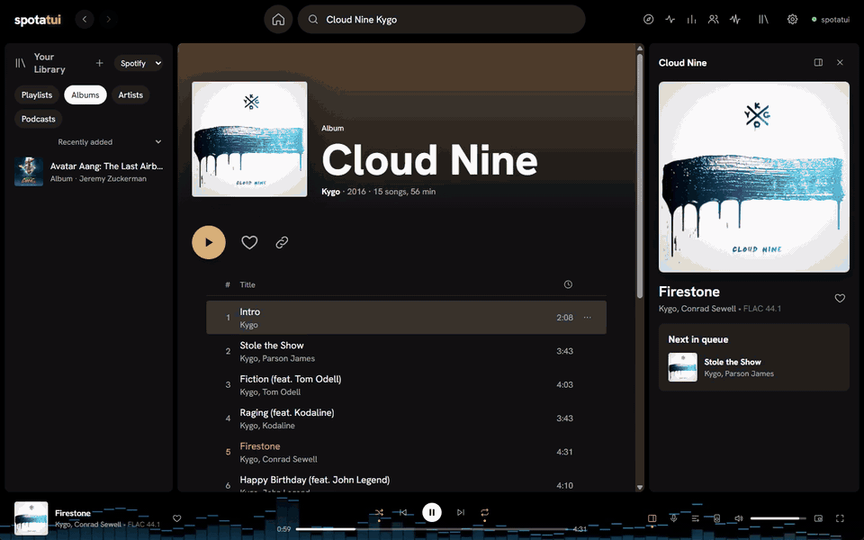
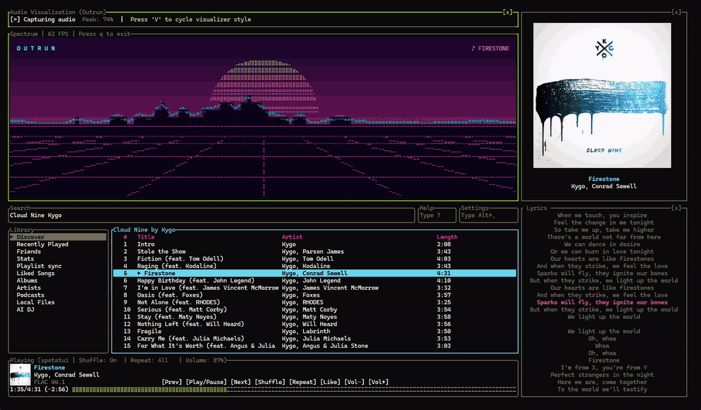

<h1 align="center">
   
  spotatui
</h1>

  Pemutar musik cepat untuk terminal dan desktop, ditulis menggunakan Rust.  
  Spotify melalui klien sendiri, ditambah file lokal, Subsonic/Navidrome, radio internet, YouTube dan Qobuz, dan Apple Music di macOS.

  <a href="https://spotatui.com/download"><strong>Download</strong></a> · <a href="#installation">Install</a> · <a href="docs/README.md">Docs</a> · <a href="CONTRIBUTING.md">Contributing</a> · <a href="https://spotatui.com/discord">Discord</a>

  <a href="README.md">English</a> | <a href="README.zh-Hans.md">简体中文</a> | <a href="README.zh-Hant.md">繁體中文</a> | <a href="README.fr.md">Français</a> | <a href="README.de.md">Deutsch</a> | <b>Bahasa Indonesia</b>

**Aplikasi desktop**

**Aplikasi terminal**

<!-- START doctoc generated TOC please keep comment here to allow auto update -->
<!-- END doctoc generated TOC please keep comment here to allow auto update -->

## Tentang spotatui

spotatui adalah pemutar musik dengan dua *frontend*: aplikasi desktop dan aplikasi terminal. Dua-duanya membagikan satu login, satu konfigurasi, dan satu <listening history>.

- Lirik yang tersinkronisasi dan visuasi audio waktu nyata.
- Antrean musik yang dapat mencapur lagu dari berbagai sumber.
- [Sinkronisasi playlist](docs/playlist-sync.md): menduplikat playlist ke Spotify, Qobuz, Subsonic, atau YouTube
- [Plugin lua](PLUGINS.md) untuk perintahan, tombol pintasan, jendela sembulan, dan tema.
- [AI DJ](docs/ai-dj.md) di aplikasi, atau agen koding Anda sebagai DJ melalui MCP.
- Riwayat mendengarkan lokal dengan statistik dan rekap yang dapat dibagikan.
- [CLI](docs/cli.md) untuk pemainan, pencarian, dan playlist.

**Spotify membutukan akum premium.** spotatui melakukan login menggunakan klien bawaannya sendiri, sehingga Anda tidak memerlukan aplikasi developer maupun client ID.

spotatui memulai sebagai sebuah fork dari [spotify-tui](https://github.com/Rigellute/spotify-tui) dan telah mengembangkan pemutar, sumber, dan aplikasi desktop sendiri.

## Instalasi

Anda tidak perlu Spotify untuk install: setiap sumber lainnya dapat digunakan tanpa akun.

**Aplikasi desktop**

| System | Download |
|---|---|
| Windows 10/11 | [Installer](https://spotatui.com/download/windows) |
| macOS | [Apple Silicon](https://spotatui.com/download/macos) · [Intel](https://spotatui.com/download/macos-intel) |
| Linux | [.deb](https://spotatui.com/download/linux-deb) · [.rpm](https://spotatui.com/download/linux-rpm) · [AppImage](https://spotatui.com/download/linux-appimage) |

Installer tersebut delum ditandatangani, sehingga Windows dan macOS akan menampilkan peringatan saat pertama kali dijalankan. Bagian [aplikasi desktop](docs/installation.md#desktop-app) menjelaskan cara membukanya serta mencantumkan file arm64 untuk Linux.

**Aplikasi terminal**

| System | Command |
|---|---|
| macOS, Linux, WSL | `curl -fsSL https://spotatui.com/install.sh \| bash` |
| Windows | `irm https://spotatui.com/install.ps1 \| iex` or `winget install spotatui` |
| Arch Linux | `yay -S spotatui-bin` |
| Dengan Rust | `cargo install --locked spotatui` |

Panduan untuk Homebrew, Nix, Void, paket .deb, serta kompilasi dari kode sumber dapat dilihat di [panduan instalasi](docs/installation.md).

- **Fitur per *build*:** Biner terminal bawaan (*prebuilt*) mencakup semua sumber (*sources*), server MCP, dan DJ AI. Perintah `cargo install` hanya menyertakan Spotify kecuali Anda menambahkan [fitur-fitur tertentu](docs/installation.md#which-build-has-which-features), dan *flake* Nix juga hanya menyertakan Spotify.
- **Pembaruan:** Aplikasi terminal dapat memperbarui dirinya sendiri secara otomatis. Jika diinstal melalui pengelola paket (*package manager*), atur `behavior.disable_auto_update: true`. Lihat [Pembaruan](docs/installation.md#updating).

## Quickstart
Jalankan `spotatui`. Saat pertama kali dibuka, aplikasi akan menanyakan sumber mana yang ingin Anda gunakan. Pilih Spotify untuk masuk: `spotatui` akan menampilkan kode dan membuka halaman penautan Spotify untuk Anda konfirmasi.

Setelah itu:

- `?` menampilkan daftar seluruh tombol pintasan.
- `/` untuk mencari. Pilih panel **Songs** menggunakan tombol panah, tekan `Enter` untuk masuk ke dalamnya, lalu tekan `Enter` lagi untuk memutar lagu.
- `d` untuk mengganti sumber dan perangkat.
- `z` untuk memasukkan lagu ke antrean, dan `Shift+Q` untuk membuka antrean.
- `spotatui --help` menampilkan panduan [CLI](docs/cli.md).

## Sumber

| Sumber | Persyaratan |
|---|---|
| **Spotify** | Akun Premium |
| **File Lokal** | Folder musik |
| **Subsonic / Navidrome** | Akun server |
| **Radio Internet** | Tidak ada (30 ribu+ stasiun radio dari [radio-browser.info](https://www.radio-browser.info)) |
| **YouTube** | [yt-dlp](https://github.com/yt-dlp/yt-dlp) terpasang di `PATH` Anda |
| **Qobuz** | Akun Qobuz berbayar |
| **Apple Music** | macOS dan aplikasi Music |

File lokal, Subsonic, Internet Radio, YouTube, dan Qobuz dimainkan melalui spotatui's mesin audio bawaan spotatui. Apple Music dimainkan melalui aplikasi Music, dan spotatui berfungsi sebagai pengendali jarak jauhnya. Cara menyetel setiap sumber dapat ditemukan di [Konfigurasi](docs/configuration.md).

Spotify dapat diputar di dalam aplikasi spotatui, maupun di perangkat apa saja melalui Spotatui Connect.

## Kontribusi

spotatui dibangun oleh tim kecil dan komunitas kontributor yang terus berkembang, dan Anda tidak perlu menulis kode apapun untuk membantu mengembangkan spotatui. Mulai dengan [CONTRIBUTING.md](CONTRIBUTING.MD), atau pilih salah satu tugas berlabel [*good first issue*](https://github.com/LargeModGames/spotatui/issues?q=is%3Aissue%20state%3Aopen%20label%3A%22good%20first%20issue%22).

## Riwayat Bintang

<a href="https://www.star-history.com/?type=date&legend=top-left&repos=LargeModGames%2Fspotatui">
 <picture>
   <source media="(prefers-color-scheme: dark)" srcset="https://api.star-history.com/chart?repos=LargeModGames/spotatui&type=date&theme=dark&legend=top-left&sealed_token=iryqtVEb4hcMJpt3uuX43JaGNlZRMV4-stDO4M8-7zH7g186IdrwSCU1PMWBv_YdK7DC4y6qw4sEKu9JXmHbR6c7clp1u8sL1AXI3D_dMW_KTnIjJYKDGw" />
   <source media="(prefers-color-scheme: light)" srcset="https://api.star-history.com/chart?repos=LargeModGames/spotatui&type=date&legend=top-left&sealed_token=iryqtVEb4hcMJpt3uuX43JaGNlZRMV4-stDO4M8-7zH7g186IdrwSCU1PMWBv_YdK7DC4y6qw4sEKu9JXmHbR6c7clp1u8sL1AXI3D_dMW_KTnIjJYKDGw" />
   
 </picture>
</a>

## Pemelihara

- **[LargeModGames](https://github.com/LargeModGames)** ([@LargeModGames](https://x.com/LargeModGames) pada X)
- [shilicioo](https://github.com/shilicioo)
- [kapok-4o](https://github.com/kapok-4o)
- [Oud](https://github.com/Oud-Idk)

Awalnya merupakan fork dari [spotify-tui](https://github.com/Rigellute/spotify-tui) karya [Alexander Keliris](https://github.com/Rigellute). Kontributor spotify-tui dan pustaka (*libraries*) yang digunakan spotatui dapat dilihat di [CREDITS.md](CREDITS.md).

## Kebijakan penandatanganan kode

Penandatanganan kode gratis disediakan oleh [SignPath.io](https://about.signpath.io), sertifikat oleh [SignPath Foundation](https://signpath.org).

File rilis untuk Windows dibangun dari repositori ini melalui [alur kerja rilis](.github/workflows/cd.yml) pada *runner* yang di-hosting oleh GitHub. Setiap permintaan penandatanganan disetujui secara manual.

- *Committers* dan peninjau: [LargeModGames](https://github.com/LargeModGames), [ThatModGames](https://github.com/ThatModGames), [shilicioo](https://github.com/shilicioo), [kapok-4o](https://github.com/kapok-4o), [Oud](https://github.com/Oud-Idk)
- Pemberi persetujuan (*approvers*): [LargeModGames](https://github.com/LargeModGames)

Privasi: lihat [kebijakan privasi](https://spotatui.com/privacy) untuk mengetahui data apa saja yang dikirimkan oleh spotatui dan cara menonaktifkannya.

# Kontributor spotatui

Semua yang membantu, dengan kode maupun tidak. Untuk masuk ke daftar ini, lihat [Recognition](CONTRIBUTING.md#recognition).

Proyek ini mengikuti spesifikasi [all-contributors](https://github.com/all-contributors/all-contributors). Kontribusi apapun diterima!
