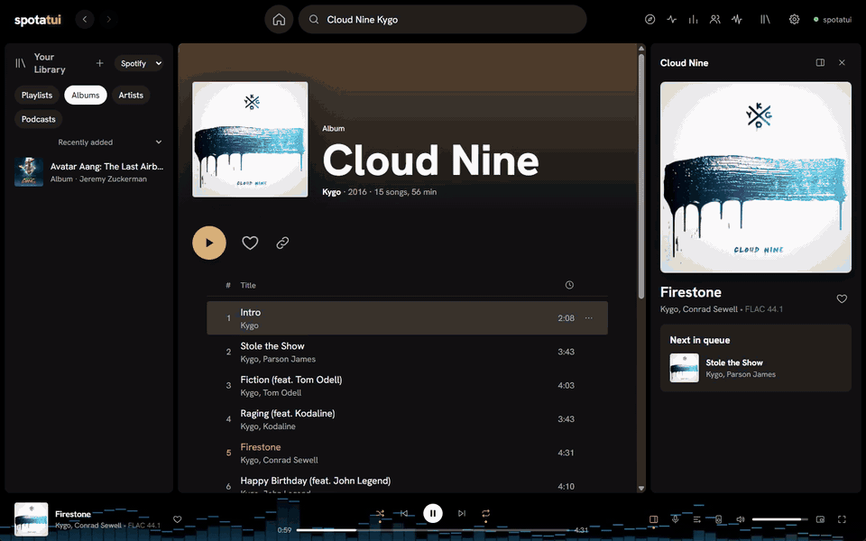
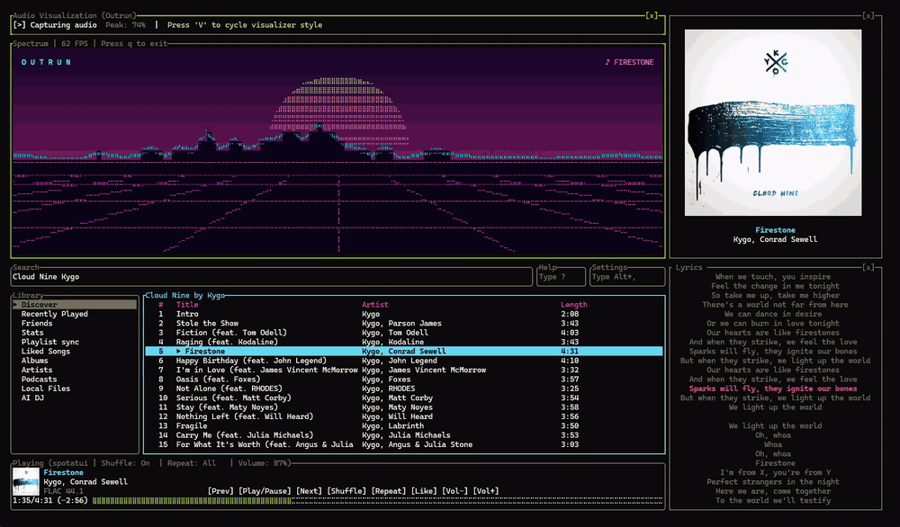

<h1 align="center">
   
  spotatui
</h1>

  一个面向终端和桌面的快速音乐播放器，用 Rust 编写。 
  通过内置客户端播放 Spotify，另外支持本地文件、Subsonic/Navidrome、网络电台、YouTube 和 Qobuz，macOS 上还支持 Apple Music。

  <a href="https://spotatui.com/download"><strong>下载</strong></a> · <a href="#安装">安装</a> · <a href="docs/README.md">文档</a> · <a href="CONTRIBUTING.md">贡献</a> · <a href="https://spotatui.com/discord">Discord</a>

  <a href="README.md">English</a> | **简体中文** | <a href="README.zh-Hant.md">繁體中文</a> | <a href="README.fr.md">Français</a> | <a href="README.de.md">Deutsch</a>

**桌面应用**

**终端应用**

<!-- START doctoc generated TOC please keep comment here to allow auto update -->
<!-- DON'T EDIT THIS SECTION, INSTEAD RE-RUN doctoc TO UPDATE -->
## 目录

- [关于](#关于)
- [安装](#安装)
- [快速上手](#快速上手)
- [音源](#音源)
- [了解更多](#了解更多)
- [贡献](#贡献)
- [播放历史](#播放历史)
- [Star 历史](#star-历史)
- [维护者](#维护者)
- [代码签名政策](#代码签名政策)
- [spotatui 贡献者](#spotatui-贡献者)

<!-- END doctoc generated TOC please keep comment here to allow auto update -->

## 关于

spotatui 是一个拥有两个前端的音乐播放器：桌面应用和终端应用。它们共享同一个登录、同一份配置和同一份收听历史。Spotify 是可选的——它是七种音源之一。

- 同步歌词，以及实时音频可视化。
- 一个可以混合不同音源曲目的播放队列。
- [播放列表同步](docs/playlist-sync.md)：把一份播放列表镜像到 Spotify、Qobuz、Subsonic 或 YouTube。
- [Lua 插件](PLUGINS.md)：命令、按键、弹窗和主题。
- 应用内置 [AI DJ](docs/ai-dj.md)，或者让你的编程代理通过 [MCP](docs/mcp-setup.md) 当 DJ。
- 本地收听历史，附带统计和可分享的年度回顾。
- 用于播放、搜索和播放列表的 [CLI](docs/cli.md)。

**Spotify 需要 Premium。** spotatui 用自己的内置客户端登录，所以你不需要开发者应用，也不需要 client ID。

spotatui 最初是 [spotify-tui](https://github.com/Rigellute/spotify-tui) 的一个分支，之后发展出了自己的播放器、音源和桌面应用。

## 安装

Spotify 是可选的：本地文件、网络电台和 YouTube 无需账号即可使用，Subsonic/Navidrome 和 Qobuz 则需要相应的账号。

**桌面应用**

| 系统 | 下载 |
|---|---|
| Windows 10/11 | [安装程序](https://spotatui.com/download/windows) |
| macOS | [Apple Silicon](https://spotatui.com/download/macos) · [Intel](https://spotatui.com/download/macos-intel) |
| Linux | [.deb](https://spotatui.com/download/linux-deb) · [.rpm](https://spotatui.com/download/linux-rpm) · [AppImage](https://spotatui.com/download/linux-appimage) |

安装程序尚未签名，所以 Windows 和 macOS 会在首次启动时发出警告。[桌面应用](docs/installation.md#desktop-app)说明了如何打开它，并列出适用于 Linux 的 arm64 文件。

**终端应用**

| 系统 | 命令 |
|---|---|
| macOS、Linux、WSL | `curl -fsSL https://spotatui.com/install.sh \| bash` |
| Windows | `irm https://spotatui.com/install.ps1 \| iex` 或 `winget install spotatui` |
| Arch Linux | `yay -S spotatui-bin` |
| 使用 Rust | `cargo install --locked spotatui` |

Homebrew、Nix、Void、`.deb` 包以及从源码构建都在[安装指南](docs/installation.md)中。

- **不同构建的功能：** 预编译的终端二进制包含所有音源、MCP 服务器和 AI DJ。`cargo install` 只构建 Spotify，除非你添加[这些功能（features）](docs/installation.md#which-build-has-which-features)；Nix flake 也只构建 Spotify。
- **更新：** 终端应用会自动更新。如果它是由包管理器安装的，请设置 `behavior.disable_auto_update: true`。参见[更新](docs/installation.md#updating)。

## 快速上手

运行 `spotatui`。首次启动会询问你想使用哪些音源。选择 Spotify 登录：spotatui 会显示一个代码并打开 Spotify 的配对页面，你在那里确认。

然后：

- `?` 列出所有按键。
- `/` 搜索。用方向键选择 **歌曲** 面板，按 `Enter` 进入，再按 `Enter` 播放一首歌。
- `d` 切换音源和设备。
- `z` 把一首歌加入队列，`Shift+Q` 打开队列。
- `spotatui --help` 显示 [CLI](docs/cli.md)。

## 音源

| 音源 | 你需要 |
|---|---|
| **Spotify** | 一个 Premium 账号 |
| **本地文件** | 一个音乐文件夹 |
| **Subsonic / Navidrome** | 一个服务器账号 |
| **网络电台** | 什么都不需要（来自 [radio-browser.info](https://www.radio-browser.info) 的 30k+ 电台） |
| **YouTube** | `PATH` 中有 [yt-dlp](https://github.com/yt-dlp/yt-dlp) |
| **Qobuz** | 一个付费 Qobuz 账号 |
| **Apple Music** | macOS 和“音乐”App |

本地文件、Subsonic、网络电台、YouTube 和 Qobuz 通过 spotatui 自己的音频引擎播放。Apple Music 在“音乐”App 中播放，spotatui 充当它的遥控器。每种音源的设置见[配置](docs/configuration.md)。

Spotify 在 spotatui 本身中播放，也可以在任意 Spotify Connect 设备上播放，或在你网络中的 Cast 和 Connect 音箱上播放。参见 [Spotify 在哪里播放](docs/native-streaming.md#where-spotify-plays)。对于无损音频，或原生流媒体无法播放的账号，spotatui 可以运行 Spotify 自己的播放器：参见 [Soloist](docs/soloist.md)。

## 了解更多

| 你想 | 阅读 |
|---|---|
| 用其他方式安装，或从源码构建 | [安装](docs/installation.md) |
| 修改设置、按键或主题 | [配置](docs/configuration.md)、[快捷键](docs/keybindings.md)、[主题](docs/themes.md) |
| 从 shell 控制 spotatui | [CLI](docs/cli.md) |
| 编写或安装 Lua 插件 | [PLUGINS.md](PLUGINS.md)、[脚本 API](docs/scripting.md) |
| 让 AI 挑选音乐 | [AI DJ](docs/ai-dj.md)、[MCP 设置](docs/mcp-setup.md) |
| 报告 bug | [新建 issue](https://github.com/LargeModGames/spotatui/issues/new/choose)，附上 `spotatui --debug` [日志](docs/configuration.md#logging) |
| 其他一切 | [全部文档](docs/README.md) |

## 贡献

spotatui 由一个小的团队和不断壮大的贡献者群体共同构建，你不需要写代码也能帮忙。从 [CONTRIBUTING.md](CONTRIBUTING.md) 开始，或者挑一个 [good first issue](https://github.com/LargeModGames/spotatui/issues?q=is%3Aissue%20state%3Aopen%20label%3A%22good%20first%20issue%22)。

原生播放和 Spotify Connect 运行在我们 fork 的 librespot——[spotatui-librespot](https://github.com/LargeModGames/spotatui-librespot) 上。它是项目的一部分：在那里合并一个 PR 也算作 spotatui 的贡献。参见[为 librespot fork 做贡献](CONTRIBUTING.md#contributing-to-the-librespot-fork)。

## 播放历史

## Star 历史

<a href="https://www.star-history.com/?type=date&legend=top-left&repos=LargeModGames%2Fspotatui">
 <picture>
   <source media="(prefers-color-scheme: dark)" srcset="https://api.star-history.com/chart?repos=LargeModGames/spotatui&type=date&theme=dark&legend=top-left&sealed_token=iryqtVEb4hcMJpt3uuX43JaGNlZRMV4-stDO4M8-7zH7g186IdrwSCU1PMWBv_YdK7DC4y6qw4sEKu9JXmHbR6c7clp1u8sL1AXI3D_dMW_KTnIjJYKDGw" />
   <source media="(prefers-color-scheme: light)" srcset="https://api.star-history.com/chart?repos=LargeModGames/spotatui&type=date&legend=top-left&sealed_token=iryqtVEb4hcMJpt3uuX43JaGNlZRMV4-stDO4M8-7zH7g186IdrwSCU1PMWBv_YdK7DC4y6qw4sEKu9JXmHbR6c7clp1u8sL1AXI3D_dMW_KTnIjJYKDGw" />
   
 </picture>
</a>

## 维护者

- **[LargeModGames](https://github.com/LargeModGames)**（X 上的 [@LargeModGames](https://x.com/LargeModGames)）
- [shilicioo](https://github.com/shilicioo)
- [2570165831](https://github.com/2570165831)
- [Oud](https://github.com/Oud-Idk)

最初由 [Alexander Keliris](https://github.com/Rigellute) 从 [spotify-tui](https://github.com/Rigellute/spotify-tui) fork 而来。spotify-tui 的贡献者以及 spotatui 使用的库见 [CREDITS.md](CREDITS.md)。

## 代码签名政策

免费代码签名由 [SignPath.io](https://about.signpath.io) 提供，证书来自 [SignPath Foundation](https://signpath.org)。

Windows 发布文件由 GitHub 托管 runner 上的[发布工作流](.github/workflows/cd.yml)从本仓库构建。每次签名请求都由人工批准。

- 提交者和审查者：[LargeModGames](https://github.com/LargeModGames)、[ThatModGames](https://github.com/ThatModGames)、[shilicioo](https://github.com/shilicioo)、[2570165831](https://github.com/2570165831)、[Oud](https://github.com/Oud-Idk)
- 批准者：[LargeModGames](https://github.com/LargeModGames)

隐私：spotatui 发送的数据以及如何关闭每一部分，请参见[隐私政策](https://spotatui.com/privacy)。

## spotatui 贡献者

每一位提供过帮助的人，无论是否写了代码。想加入这份名单，请参见[致谢](CONTRIBUTING.md#recognition)。

完整的贡献者名单见 [English README](README.md#spotatui-contributors)。本项目遵循 [all-contributors](https://github.com/all-contributors/all-contributors) 规范。
