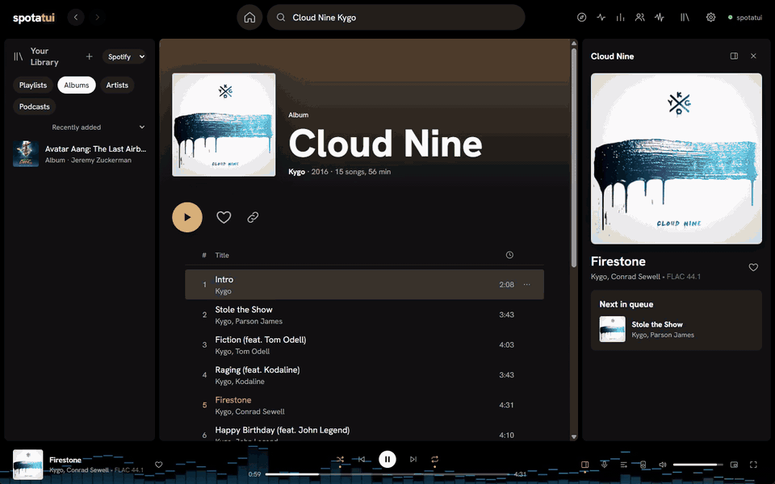
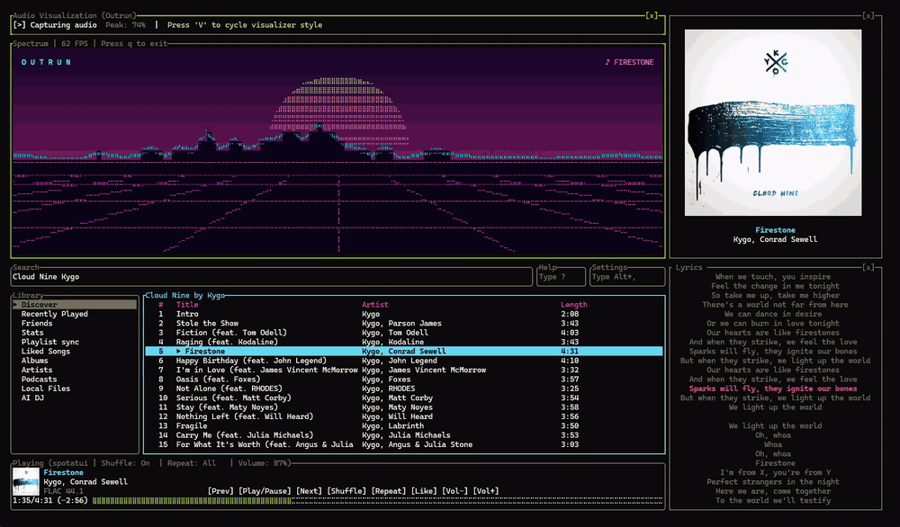

<h1 align="center">
   
  spotatui
</h1>

  一個適用於終端機和桌面的快速音樂播放器，以 Rust 撰寫。 
  透過內建用戶端播放 Spotify，另外支援本機檔案、Subsonic/Navidrome、網路電台、YouTube 和 Qobuz，macOS 上還支援 Apple Music。

  <a href="https://spotatui.com/download"><strong>下載</strong></a> · <a href="#安裝">安裝</a> · <a href="docs/README.md">文件</a> · <a href="CONTRIBUTING.md">貢獻</a> · <a href="https://spotatui.com/discord">Discord</a>

  <a href="README.md">English</a> | <a href="README.zh-Hans.md">简体中文</a> | **繁體中文** | <a href="README.fr.md">Français</a> | <a href="README.de.md">Deutsch</a>

**桌面應用程式**

**終端機應用程式**

<!-- START doctoc generated TOC please keep comment here to allow auto update -->
<!-- DON'T EDIT THIS SECTION, INSTEAD RE-RUN doctoc TO UPDATE -->
## 目錄

- [關於](#關於)
- [安裝](#安裝)
- [快速開始](#快速開始)
- [音源](#音源)
- [了解更多](#了解更多)
- [貢獻](#貢獻)
- [播放紀錄](#播放紀錄)
- [Star 歷史](#star-歷史)
- [維護者](#維護者)
- [程式碼簽署政策](#程式碼簽署政策)
- [spotatui 貢獻者](#spotatui-貢獻者)

<!-- END doctoc generated TOC please keep comment here to allow auto update -->

## 關於

spotatui 是一個擁有兩個前端的音樂播放器：桌面應用程式和終端機應用程式。它們共用同一組登入、同一份設定和同一份收聽紀錄。Spotify 是選擇性的——它是七種音源之一。

- 同步歌詞，以及即時音訊視覺化。
- 一個可以混合不同音源曲目的播放佇列。
- [播放清單同步](docs/playlist-sync.md)：把一份播放清單鏡像到 Spotify、Qobuz、Subsonic 或 YouTube。
- [Lua 外掛](PLUGINS.md)：指令、按鍵、彈出視窗和主題。
- 應用程式內建 [AI DJ](docs/ai-dj.md)，或者讓你的程式代理透過 [MCP](docs/mcp-setup.md) 當 DJ。
- 本機收聽紀錄，附帶統計和可分享的年度回顧。
- 用於播放、搜尋和播放清單的 [CLI](docs/cli.md)。

**Spotify 需要 Premium。** spotatui 用自己的內建用戶端登入，所以你不需要開發者應用程式，也不需要 client ID。

spotatui 最初是 [spotify-tui](https://github.com/Rigellute/spotify-tui) 的一個分支，之後發展出了自己的播放器、音源和桌面應用程式。

## 安裝

Spotify 是選擇性的：本機檔案、網路電台和 YouTube 無需帳號即可使用，Subsonic/Navidrome 和 Qobuz 則需要相應的帳號。

**桌面應用程式**

| 系統 | 下載 |
|---|---|
| Windows 10/11 | [安裝程式](https://spotatui.com/download/windows) |
| macOS | [Apple Silicon](https://spotatui.com/download/macos) · [Intel](https://spotatui.com/download/macos-intel) |
| Linux | [.deb](https://spotatui.com/download/linux-deb) · [.rpm](https://spotatui.com/download/linux-rpm) · [AppImage](https://spotatui.com/download/linux-appimage) |

安裝程式尚未簽署，所以 Windows 和 macOS 會在首次啟動時發出警告。[桌面應用程式](docs/installation.md#desktop-app)說明了如何開啟它，並列出適用於 Linux 的 arm64 檔案。

**終端機應用程式**

| 系統 | 指令 |
|---|---|
| macOS、Linux、WSL | `curl -fsSL https://spotatui.com/install.sh \| bash` |
| Windows | `irm https://spotatui.com/install.ps1 \| iex` 或 `winget install spotatui` |
| Arch Linux | `yay -S spotatui-bin` |
| 使用 Rust | `cargo install --locked spotatui` |

Homebrew、Nix、Void、`.deb` 套件以及從原始碼建置都在[安裝指南](docs/installation.md)中。

- **不同建置的功能：** 預編譯的終端機二進位檔包含所有音源、MCP 伺服器和 AI DJ。`cargo install` 只建置 Spotify，除非你加入[這些功能（features）](docs/installation.md#which-build-has-which-features)；Nix flake 也只建置 Spotify。
- **更新：** 終端機應用程式會自動更新。如果它是由套件管理員安裝的，請設定 `behavior.disable_auto_update: true`。參見[更新](docs/installation.md#updating)。

## 快速開始

執行 `spotatui`。首次啟動會詢問你想使用哪些音源。選擇 Spotify 登入：spotatui 會顯示一個代碼並開啟 Spotify 的配對頁面，你在那裡確認。

然後：

- `?` 列出所有按鍵。
- `/` 搜尋。用方向鍵選擇 **歌曲** 面板，按 `Enter` 進入，再按 `Enter` 播放一首歌。
- `d` 切換音源和裝置。
- `z` 把一首歌加入佇列，`Shift+Q` 開啟佇列。
- `spotatui --help` 顯示 [CLI](docs/cli.md)。

## 音源

| 音源 | 你需要 |
|---|---|
| **Spotify** | 一個 Premium 帳號 |
| **本機檔案** | 一個音樂資料夾 |
| **Subsonic / Navidrome** | 一個伺服器帳號 |
| **網路電台** | 什麼都不需要（來自 [radio-browser.info](https://www.radio-browser.info) 的 30k+ 電台） |
| **YouTube** | `PATH` 中有 [yt-dlp](https://github.com/yt-dlp/yt-dlp) |
| **Qobuz** | 一個付費 Qobuz 帳號 |
| **Apple Music** | macOS 和「音樂」App |

本機檔案、Subsonic、網路電台、YouTube 和 Qobuz 透過 spotatui 自己的音訊引擎播放。Apple Music 在「音樂」App 中播放，spotatui 充當它的遙控器。每種音源的設定見[設定](docs/configuration.md)。

Spotify 在 spotatui 本身中播放，也可以在任意 Spotify Connect 裝置上播放，或在你網路中的 Cast 和 Connect 音箱上播放。參見 [Spotify 在哪裡播放](docs/native-streaming.md#where-spotify-plays)。對於無損音訊，或原生串流無法播放的帳號，spotatui 可以執行 Spotify 自己的播放器：參見 [Soloist](docs/soloist.md)。

## 了解更多

| 你想 | 閱讀 |
|---|---|
| 用其他方式安裝，或從原始碼建置 | [安裝](docs/installation.md) |
| 修改設定、按鍵或主題 | [設定](docs/configuration.md)、[快速鍵](docs/keybindings.md)、[主題](docs/themes.md) |
| 從 shell 控制 spotatui | [CLI](docs/cli.md) |
| 撰寫或安裝 Lua 外掛 | [PLUGINS.md](PLUGINS.md)、[腳本 API](docs/scripting.md) |
| 讓 AI 挑選音樂 | [AI DJ](docs/ai-dj.md)、[MCP 設定](docs/mcp-setup.md) |
| 回報 bug | [新增 issue](https://github.com/LargeModGames/spotatui/issues/new/choose)，附上 `spotatui --debug` [紀錄](docs/configuration.md#logging) |
| 其他一切 | [全部文件](docs/README.md) |

## 貢獻

spotatui 由一個小的團隊和不斷壯大的貢獻者群體共同建構，你不需要寫程式碼也能幫忙。從 [CONTRIBUTING.md](CONTRIBUTING.md) 開始，或者挑一個 [good first issue](https://github.com/LargeModGames/spotatui/issues?q=is%3Aissue%20state%3Aopen%20label%3A%22good%20first%20issue%22)。

原生播放和 Spotify Connect 執行在我們 fork 的 librespot——[spotatui-librespot](https://github.com/LargeModGames/spotatui-librespot) 上。它是專案的一部分：在那裡合併一個 PR 也算作 spotatui 的貢獻。參見[為 librespot fork 做貢獻](CONTRIBUTING.md#contributing-to-the-librespot-fork)。

## 播放紀錄

## Star 歷史

<a href="https://www.star-history.com/?type=date&legend=top-left&repos=LargeModGames%2Fspotatui">
 <picture>
   <source media="(prefers-color-scheme: dark)" srcset="https://api.star-history.com/chart?repos=LargeModGames/spotatui&type=date&theme=dark&legend=top-left&sealed_token=iryqtVEb4hcMJpt3uuX43JaGNlZRMV4-stDO4M8-7zH7g186IdrwSCU1PMWBv_YdK7DC4y6qw4sEKu9JXmHbR6c7clp1u8sL1AXI3D_dMW_KTnIjJYKDGw" />
   <source media="(prefers-color-scheme: light)" srcset="https://api.star-history.com/chart?repos=LargeModGames/spotatui&type=date&legend=top-left&sealed_token=iryqtVEb4hcMJpt3uuX43JaGNlZRMV4-stDO4M8-7zH7g186IdrwSCU1PMWBv_YdK7DC4y6qw4sEKu9JXmHbR6c7clp1u8sL1AXI3D_dMW_KTnIjJYKDGw" />
   
 </picture>
</a>

## 維護者

- **[LargeModGames](https://github.com/LargeModGames)**（X 上的 [@LargeModGames](https://x.com/LargeModGames)）
- [shilicioo](https://github.com/shilicioo)
- [2570165831](https://github.com/2570165831)
- [Oud](https://github.com/Oud-Idk)

最初由 [Alexander Keliris](https://github.com/Rigellute) 從 [spotify-tui](https://github.com/Rigellute/spotify-tui) fork 而來。spotify-tui 的貢獻者以及 spotatui 使用的函式庫見 [CREDITS.md](CREDITS.md)。

## 程式碼簽署政策

免費程式碼簽署由 [SignPath.io](https://about.signpath.io) 提供，憑證來自 [SignPath Foundation](https://signpath.org)。

Windows 發行檔案由 GitHub 託管的 runner 上的[發行工作流程](.github/workflows/cd.yml)從本倉庫建置。每次簽署請求都由人工批准。

- 提交者和審查者：[LargeModGames](https://github.com/LargeModGames)、[ThatModGames](https://github.com/ThatModGames)、[shilicioo](https://github.com/shilicioo)、[2570165831](https://github.com/2570165831)、[Oud](https://github.com/Oud-Idk)
- 批准者：[LargeModGames](https://github.com/LargeModGames)

隱私：spotatui 傳送的資料以及如何關閉每一部分，請參見[隱私權政策](https://spotatui.com/privacy)。

## spotatui 貢獻者

每一位提供過幫助的人，無論是否寫了程式碼。想加入這份名單，請參見[致謝](CONTRIBUTING.md#recognition)。

完整的貢獻者名單見 [English README](README.md#spotatui-contributors)。本專案遵循 [all-contributors](https://github.com/all-contributors/all-contributors) 規範。
